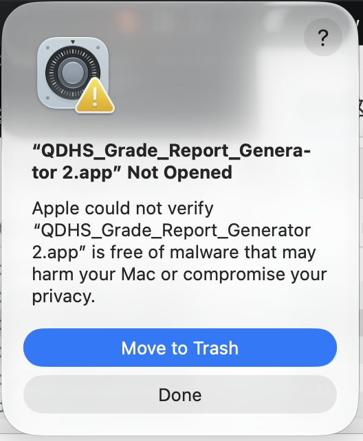
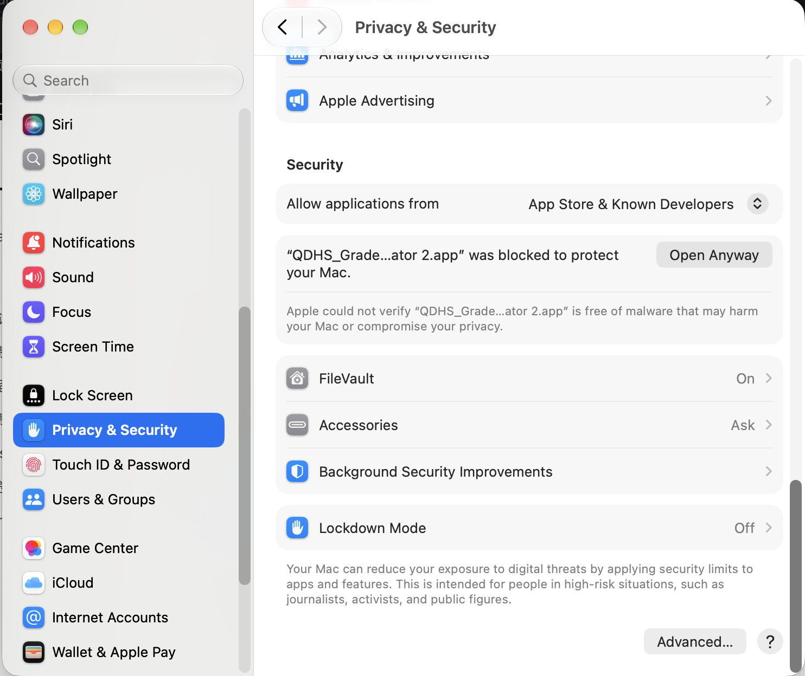
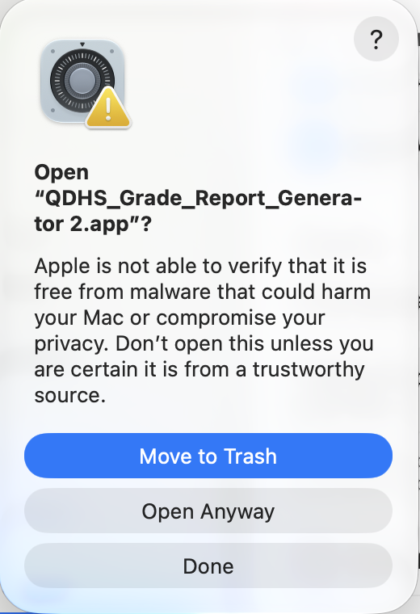
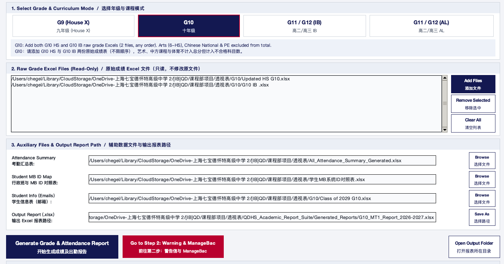
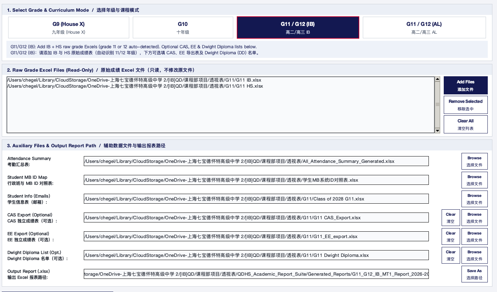
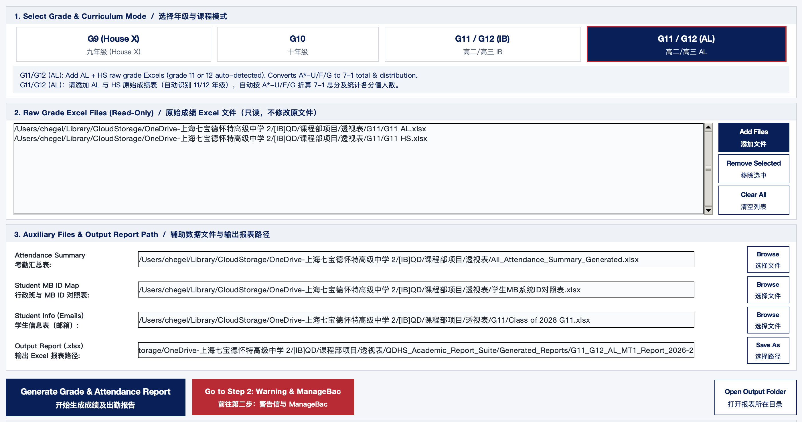
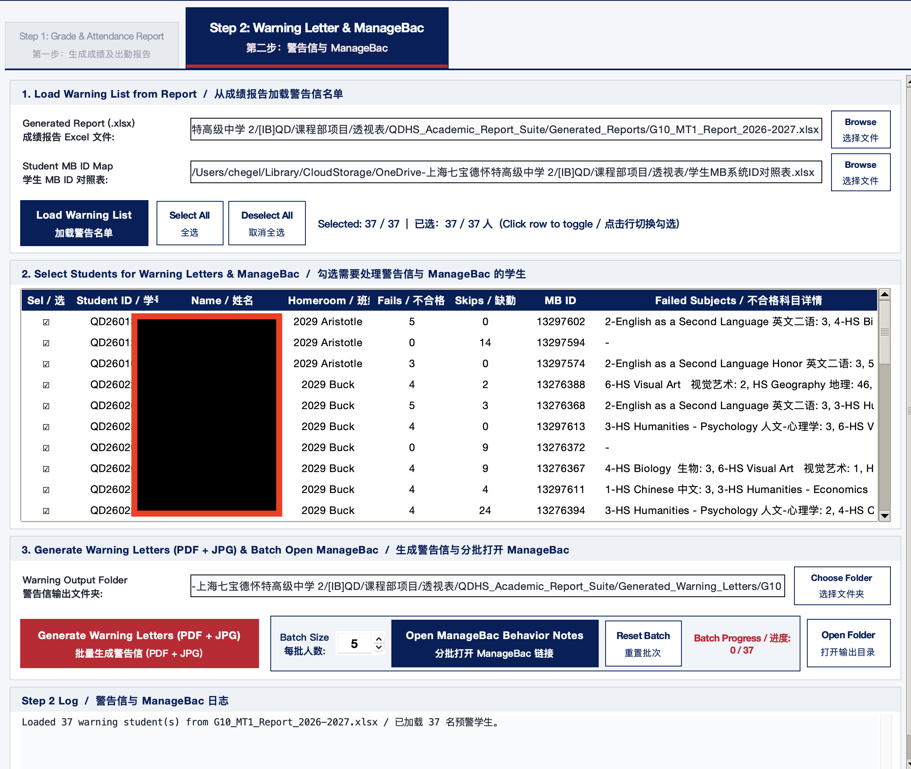

# QD Grade Report Suite v1.0 Manual

# QD 成绩报告生成器 v1.0 使用说明书

## Download and Setup

## 下载与安装

Visit the link below to select the installer for your operating system:  
[QDGradeReportSuit v1.0](https://github.com/chegelchen/QDGradeReportSuit/releases/tag/1.0)

请访问以下网址，选择对应操作系统的程序版本：  
[QDGradeReportSuit v1.0](https://github.com/chegelchen/QDGradeReportSuit/releases/tag/1.0)

You can also download the installers directly using the links below:  
[macOS Installer](https://github.com/chegelchen/QDGradeReportSuit/releases/download/1.0/QDGradeReportSuit_macOS_AppleSilicon.dmg)  
[Windows Installer](https://github.com/chegelchen/QDGradeReportSuit/releases/download/1.0/QDGradeReportSuit.exe)

也可以直接点击以下链接下载对应安装包：  
[macOS 安装包](https://github.com/chegelchen/QDGradeReportSuit/releases/download/1.0/QDGradeReportSuit_macOS_AppleSilicon.dmg)  
[Windows 安装包](https://github.com/chegelchen/QDGradeReportSuit/releases/download/1.0/QDGradeReportSuit.exe)

> Please note that I haven't had a chance to test the Windows version in a Windows environment yet, so I would appreciate it if anyone could help test it and share their feedback.

> 请注意，Windows 版本尚未在真实 Windows 环境下完成测试，欢迎大家协助测试并反馈使用情况。

> **Tip:** Since this application is not signed with an official digital certificate, both macOS and Windows may display a security warning on first launch. Simply choose **Open Anyway** (macOS) or **Run anyway** (Windows) to continue.

> **提示：** 由于本程序未购买官方数字签名证书，首次运行时 macOS 和 Windows 系统均可能会弹出安全警告。在提示中选择 **仍要打开**（macOS）或 **仍要运行**（Windows）即可继续使用。

When launching the macOS version for the first time, you will see the following security prompt:

首次打开 macOS 版本时，系统会弹出如下安全提示：

Click **Done**, then open **System Settings -> Privacy & Security**.

点击 **Done（完成）**，然后打开 **系统设置 → 隐私与安全性**。

Scroll down and click **Open Anyway**, then click **Open Anyway** again to confirm.

向下滚动并点击 **Open Anyway（仍要打开）**，在随后弹出的确认框中再次点击 **Open Anyway（仍要打开）**。

Enter your Mac login password to launch the application.

输入电脑开机密码即可正常打开程序。

---

## Usage Guide

## 运行与使用说明

Because each grade level uses different data sources and total-score rules, the interface provides a dedicated mode for each grade and curriculum track.

由于各年级的数据来源及总分计算规则不同，程序为不同年级和课程体系分别设置了专属处理模式。

### G10 and House X (G9)

### G10 与 House X (G9)

The raw grade files include both IB and HS course grade sheets; please add them in **Section 2 (Raw Grade Excel Files)**.

原始成绩数据包含 IB 课程成绩表与 HS 课程成绩表，请将文件添加至 **第 2 栏（原始成绩 Excel 文件）**。

In **Section 3 (Auxiliary Files & Output Report Path)**, import the student attendance summary file (generated mid-semester by a separate tool), the ManageBac ID–Student ID mapping table, and the student information sheet in order.

在 **第 3 栏（辅助数据文件与输出报表路径）** 中，依次导入学生考勤汇总表（由另一款软件每半学期生成一次）、学生 MB 系统 ID 与学号对照表以及学生信息表。

Click **Generate Grade & Attendance Report** to generate the summary workbook.

点击 **【开始生成成绩及出勤报告】** 按钮，即可生成成绩及出勤汇总表。

### G11 / G12 IB (DP & DD)

### G11 / G12 IB (DP 与 DD)

Because Dwight Diploma (DD) students take the same courses as IB DP students, grade summaries for both Grade 11 and Grade 12 IB DP and DD students are generated in this mode.

由于 Dwight Diploma (DD) 学生与 IB DP 学生修读相同的课程，11 年级和 12 年级的 IB DP 与 DD 成绩汇总表均在此模式下统一生成。

In **Section 3**, you can also import the standalone CAS export, EE export, and the Dwight Diploma (DD) student roster.

在 **第 3 栏** 中，需额外导入 CAS 独立成绩表、EE 独立成绩表以及 Dwight Diploma (DD) 学生名单。

### G11 / G12 AL

### G11 / G12 AL

For Grade 11 and Grade 12 A-Level students, import both the AL course grade sheet and the HS course grade sheet in Section 2.

11 年级和 12 年级的 A-Level 学生需要在第 2 栏同时导入 AL 课程成绩表与 HS 课程成绩表。

### Generating Warning Letters & Sending via ManageBac

### 生成警告信并在 ManageBac 发送通知

Click the **Step 2** tab or button to preview and select the students who require a warning letter.

点击顶部的 **【Step 2】** 标签或 **【前往第二步】** 按钮，即可预览并勾选需要生成警告信的学生名单。

Warning letters are generated in both PDF and JPG formats simultaneously—PDF files are for archiving, while JPG images can be copied and pasted directly into ManageBac.

警告信会同时生成 PDF 文件和 JPG 图片两种格式：PDF 用于留档保存，JPG 图片便于直接复制粘贴至 ManageBac。

Click **Generate Warning Letters (PDF + JPG)**, and once complete, click **Open Folder** on the right to view the generated files.

点击 **【批量生成警告信 (PDF + JPG)】** 按钮，生成完成后可点击右侧 **【打开输出目录】** 查看文件。

Finally, click **Open ManageBac Behavior Notes** to open each selected student's ManageBac Behavior Note page in batches via your browser so you can submit the warning notices one by one.

最后点击 **【分批打开 ManageBac 链接】** 按钮，浏览器会分批打开对应学生的 ManageBac Behavior Note 新建页面，方便逐一发送警告信通知。

---

**P.S.**

The source code is available on GitHub:  
https://github.com/chegelchen/QDGradeReportSuit

源代码已开源发布在 GitHub：  
https://github.com/chegelchen/QDGradeReportSuit

Anyone who would like to review or access the code is welcome to do so at any time.

欢迎任何有需要的老师或开发者随时查阅和使用源码。
